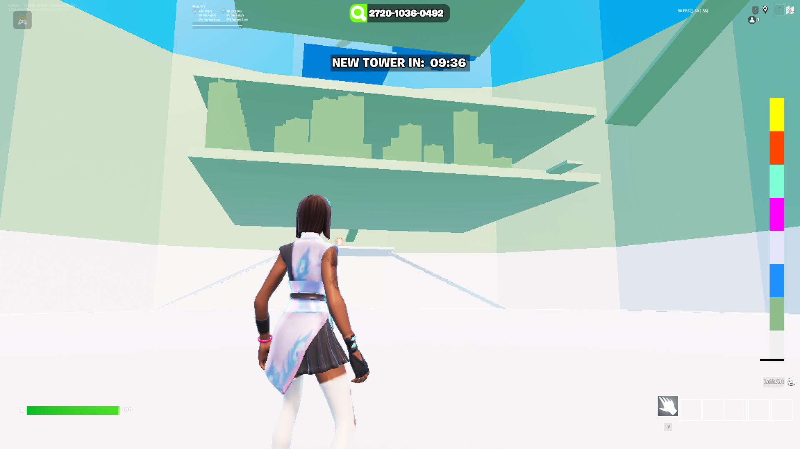
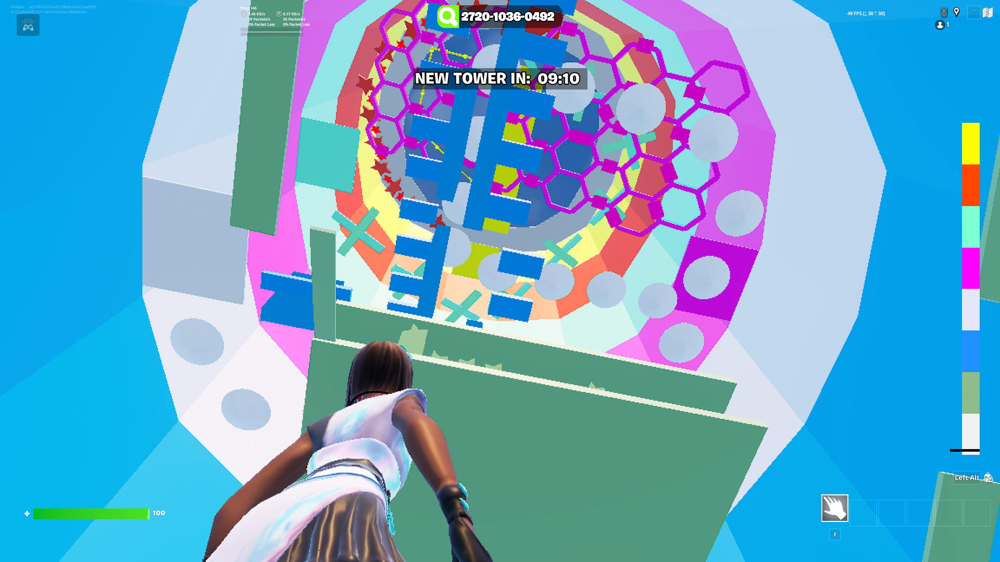

# Tower of Easy Parkour

Tower of Easy Parkour is a multiplayer parkour game built in **Unreal Editor for Fortnite (UEFN)** using **Verse** and **Scene Graph**. Players race to reach the top of a tower while avoiding obstacles and adapting to a course that changes over time.

## Play the Game

**Fortnite island code:** `2720-1036-0492`

Open Fortnite, go to **Search**, and enter the island code to play Tower of Easy Parkour.

## Gameplay

- **Reach the top:** Climb the parkour course to complete it.
- **Avoid obstacles:** Touching neon-colored hazards eliminates the player. If a player is eliminated or falls, they return to their most recently reached checkpoint rather than losing all their progress in the current course.
- **Race against the clock:** A countdown tracks the time remaining for the current course. When players reach the top, the countdown speeds up; the more players who finish, the faster it runs.
- **Explore changing courses:** Every round, one of **five** courses is selected at random. When the timer reaches zero, the current course is removed, all players return to the starting area with their checkpoints reset, and a new course is spawned in the same location.

## Technology

| Technology | Use in this project |
| --- | --- |
| **UEFN** | Building the Fortnite island and configuring the game environment. |
| **Verse** | Implementing gameplay behavior, the course rotation system, and player-facing information. |
| **Scene Graph** | Organizing and managing the parkour courses so that the active course can be removed and another spawned. |

## Gameplay Preview

[Watch gameplay footage on YouTube](https://youtu.be/syjvCpAUobQ) 

## Project Documentation

This repository contains the Verse source code and technical documentation for Tower of Easy Parkour.

The key technical feature is the **dynamic course rotation system**, which uses Scene Graph to remove the active course and spawn a randomly selected replacement.

For more information:

- [Game Overview](docs/01-Game-Overview.md) — An overview of the gameplay mechanics, checkpoints, and course rotation.
- [Technical Overview](docs/02-Technical-Overview.md) — An explanation of the Verse architecture, Scene Graph prefabs, course management, and other gameplay systems.

### Source Code

The `src/` directory contains the Verse source files used to implement the game's functionality.

**Note:** This repository showcases the Verse source code and technical documentation. The complete UEFN project, including its level assets and prefab configurations, is not included.

## More Games

Explore my other Fortnite projects on [Fortnite.gg](https://fortnite.gg/creator/creativenight).
