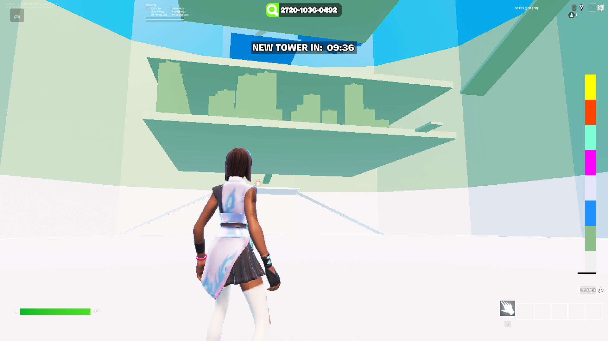
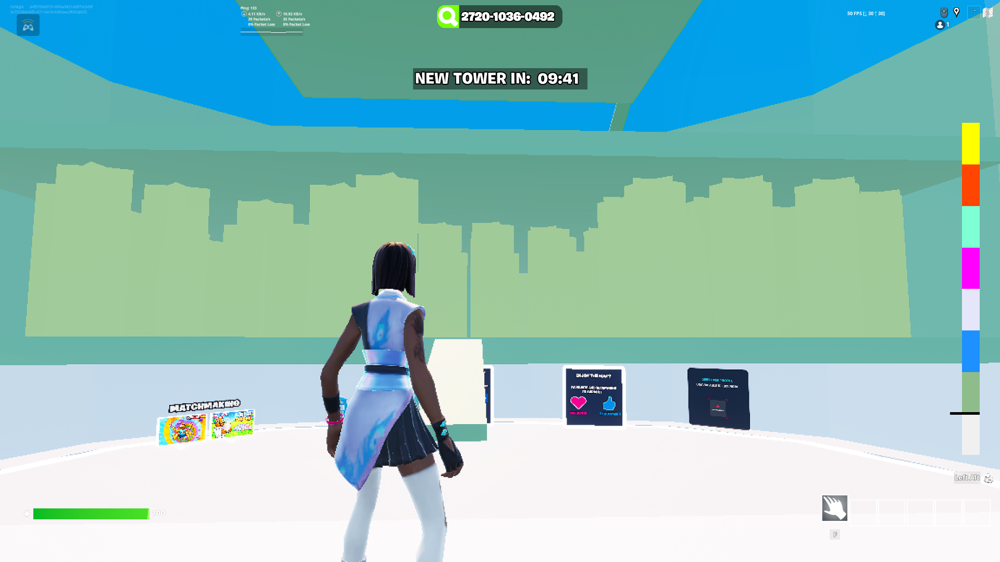
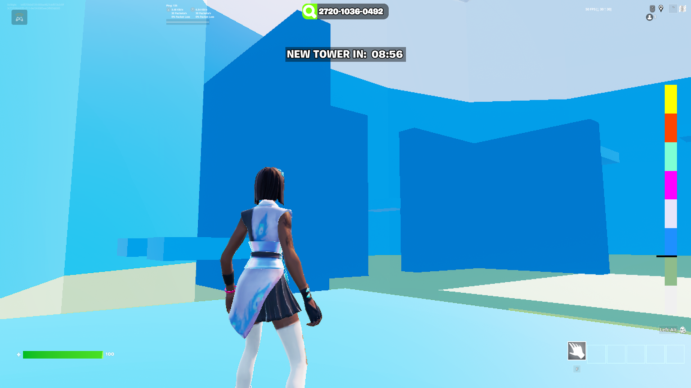
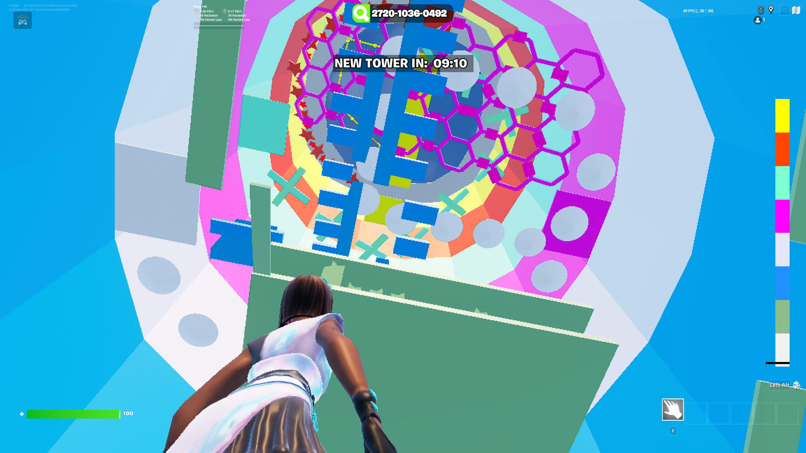
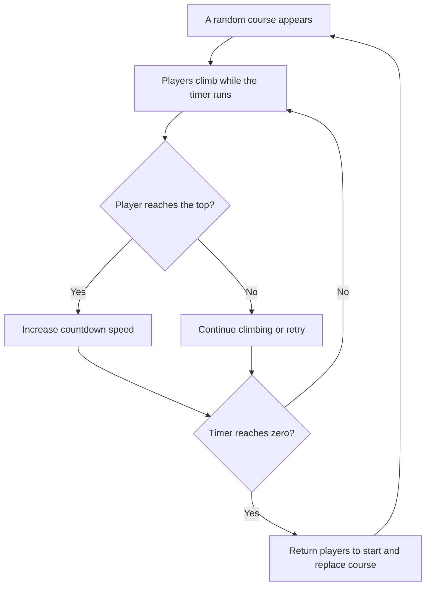

# 01 — Game Overview

## About Tower of Easy Parkour

**Tower of Easy Parkour** is a multiplayer parkour experience created in Unreal Editor for Fortnite (UEFN). Players attempt to climb an obstacle course before the round ends. Unlike a fixed parkour map, the playable course changes between rounds, giving players a new route to attempt.

The island uses **Verse** for gameplay behavior and **Scene Graph** to manage the course that is currently present in the level.

**Fortnite island code:** `2720-1036-0492`

## Objective

The player's main goal is to reach the top of the active parkour course. All players in the session attempt the same course at the same time.

Along the way:

- Players jump and navigate platforms to climb higher.
- Touching a neon-colored hazard eliminates the player and returns them to their most recent checkpoint.
- Falling from the course also returns the player to their most recent checkpoint.
- Reaching the top counts as completing the current course and affects the remaining round time.

### Neon Hazard Obstacles

Some sections of the tower contain brightly colored obstacles that players must avoid while navigating the platforms. Touching one of these hazards eliminates the player and returns them to their last checkpoint. The screenshots below show examples of these obstacle sections from a player's perspective.

### Checkpoints

As players climb the tower, they can reach checkpoints that record their progress. If they fall or are eliminated by an obstacle, they respawn at the most recent checkpoint instead of restarting the entire climb. Checkpoints are reset when the current round ends, so everyone begins the next course from the starting area.

## Round System

A round begins with one active parkour course and a **10-minute countdown**. There are **five available courses**, and the game selects a course at random.

The round timer is shared across the experience. Players can attempt the course while the countdown is running, regardless of whether other players have already reached the top.

### Countdown Acceleration

Completing a course also influences how soon the next round starts:

1. The timer initially counts down at its normal rate.
2. When a player reaches the top, the countdown speeds up.
3. As more players reach the top, the countdown accelerates further.

This means the actual duration of a round can be shorter than ten minutes, depending on how many players finish. The more players who complete the course, the sooner the next course arrives.

## Dynamic Course Rotation

When the countdown reaches zero, the game performs a round transition:

1. All players are returned to the starting area, including anyone partway through the course, and their checkpoints are reset.
2. The current course is **removed** from the level.
3. A new course is randomly selected from the available courses.
4. The selected course is **spawned in the same location** as the previous one.
5. The countdown resets and a new round begins.

The system replaces the actual course rather than simply hiding one course and showing another. Course management is built around UEFN's Scene Graph functionality.

## Player Interface

The game includes an interface to help players understand the current round and their progress:

| Interface | Purpose |
| --- | --- |
| **Countdown** | Shows how much time remains before the active course changes. |
| **Countdown multiplier** | Communicates the increased countdown speed after players reach the top. |
| **Tower progress display** | Shows a player's progress while climbing the course. |

## Gameplay Flow Summary

## Gameplay Footage

[Watch the gameplay preview on YouTube](https://youtu.be/syjvCpAUobQ).

## Technical Documentation

This document describes the game from the player's perspective. The following technical documentation will explain the Verse components, Scene Graph course prefabs, random course selection, countdown behavior, and how the course is removed and replaced.
