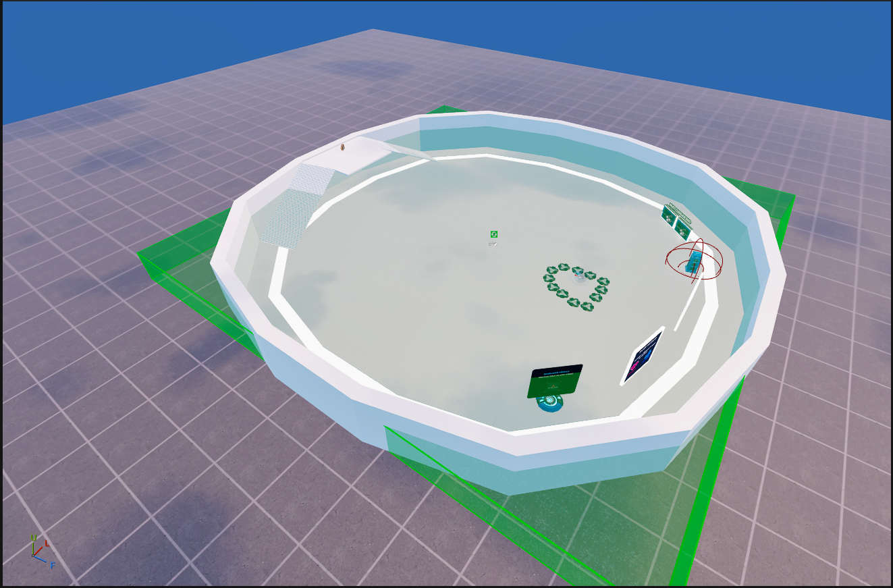
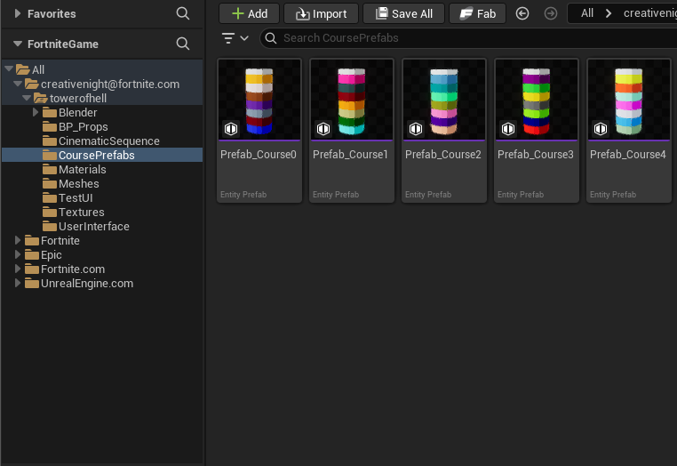
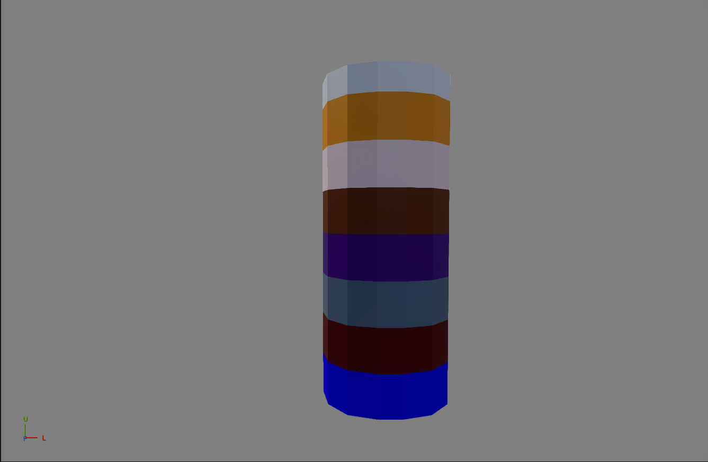
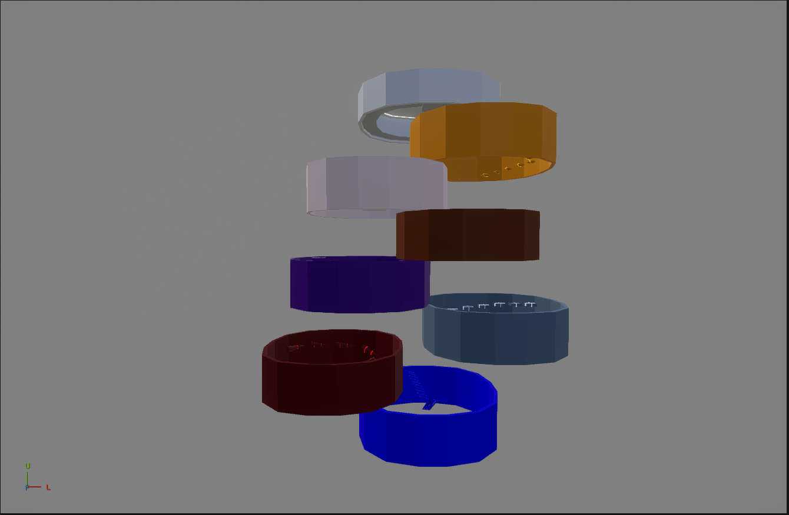
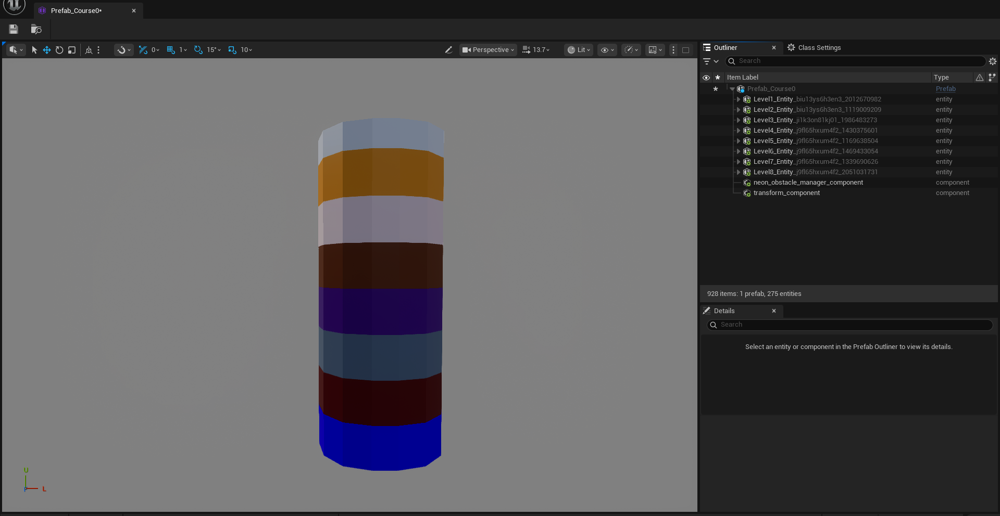
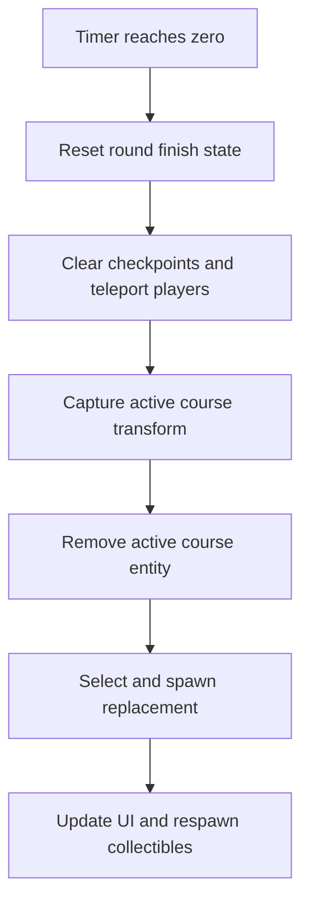
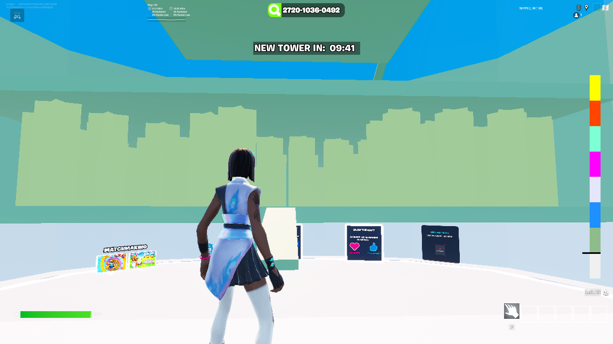

# 02 — Technical Overview

## Purpose

This document explains how **Tower of Easy Parkour** uses **Verse** and UEFN's **Scene Graph** to run a multiplayer parkour game with dynamically replaced courses. It focuses on the implementation and the responsibilities of the source files; the [game overview](01-Game-Overview.md) explains the experience from a player's perspective.

## UEFN, Verse, and Scene Graph

- **Unreal Editor for Fortnite (UEFN)** is the editor used to build the island and configure objects, gameplay devices, and their settings.
- **Verse** is the programming language that implements the game rules, responds to gameplay events, and updates interfaces.
- **Scene Graph** represents the level using **entities** and **components**. An entity is a game-world object; components attach behavior or data to it. A **prefab** is a reusable arrangement of entities that the game can construct and add to the running level.

To learn more about Scene Graph, see [Epic Games' official Scene Graph documentation](https://dev.epicgames.com/documentation/en-us/fortnite/scene-graph-in-unreal-editor-for-fortnite).

In this project, a parkour course is constructed from a prefab. The manager stores a reference to the active course entity so it can remove that course and create another one without keeping all five courses in the world at once.

### The permanent starting area

The island has a permanent base area where players start. This area remains in place while the active parkour course changes above it. The screenshot shows the base in the UEFN editor before a course has been spawned.



## Verse File Structure

```text
UserInterface/
├── global_countdown_ui.verse
├── tower_progress_ui.verse
└── ui_manager.verse

movement_component.verse
neon_obstacle_manager_component.verse
obstacle_course_colors.verse
obstacle_course_prefab_manager_component.verse
obstacle_course_prefab.verse
utility_module.verse
```

| File | Responsibility |
| --- | --- |
| `obstacle_course_prefab_manager_component.verse` | Central round controller: selects and spawns courses, runs the countdown, tracks finishes, resets players, and replaces courses. |
| `obstacle_course_prefab.verse` | Defines course types that construct the five Scene Graph prefab assets (`Prefab_Course0` through `Prefab_Course4`). |
| `neon_obstacle_manager_component.verse` | Finds marked neon obstacles, listens for contact, and damages characters that touch them. |
| `movement_component.verse` | Applies configured keyframes to a Scene Graph entity and plays its animation. |
| `obstacle_course_colors.verse` | Stores the color palette for each course's progress display. |
| `UserInterface/ui_manager.verse` | Coordinates creation, display, updates, and removal of player UI. |
| `UserInterface/global_countdown_ui.verse` | Displays remaining round time and the active countdown multiplier. |
| `UserInterface/tower_progress_ui.verse` | Draws the vertical tower progress bar and updates a player's marker based on height. |
| `utility_module.verse` | Shared helper functions, including event subscription wrappers and formatting utilities. |

## 1. Starting the Game

The main controller is `obstacle_course_prefab_manager_component`, a Scene Graph **component** attached to an entity in the level.

During `OnBeginSimulation`, the manager subscribes to gameplay events, including:

- Entering the final platform's `mutator_zone_device` (course completion).
- Player elimination events.
- Ground and stage zone entry events.
- Collectible coin events.
- The round-start event.

When a round starts, `StartGame()` calls `SpawnRandomCourse()`, starts player/UI initialization, and launches the timer loop. Because multiple activities must continue together, asynchronous Verse functions (`<suspends>`) and `spawn` are used for work such as UI refreshes and the countdown.

## 2. Selecting and Spawning a Course

The manager holds an editable array:

```verse
@editable
CourseArray:[]obstacle_course_prefab=array{}
```

Each entry exposes `ConstructObstacleCoursePrefab()`. The five concrete course classes construct their respective prefab assets, keeping the central manager independent of the details of each course's geometry.

In the UEFN Content Browser, all five prefab assets are grouped in a `CoursePrefabs` folder. Each asset represents a complete tower that can be constructed when selected by the game.



**Selection:** `GetNextCourseIndex()` selects an index using `GetRandomInt()`. It also checks a recent-course history to reduce immediate repeats when more than two courses are configured.

**Instantiation:** `SpawnCourse()` constructs the selected prefab entity, calculates its transform, and adds it to the simulation with `AddEntities()`. The manager then retains it in `CurrentCourseEntity`.

The spawn function explicitly sets scale to `(1.0, 1.0, 1.0)` while keeping the chosen position and rotation. This prevents the spawned course from inheriting an unwanted scale from its manager entity.

### Scene Graph prefab structure

A course prefab is not one indivisible object. It is assembled from multiple child entities that represent its individual parkour levels. Each level contains its own arrangement of platforms and obstacles, allowing the full tower to be treated as one reusable prefab when the game spawns it.

The first image shows a complete tower prefab. The second separates the levels visually to make its layered construction easier to see.





The prefab editor's **Outliner** shows this structure explicitly. For the example `Prefab_Course0`, it lists the level entities alongside components attached to the prefab root:

```text
Prefab_Course0
├── Level1_Entity
├── Level2_Entity
├── Level3_Entity
├── Level4_Entity
├── Level5_Entity
├── Level6_Entity
├── Level7_Entity
├── Level8_Entity
├── neon_obstacle_manager_component
└── transform_component
```



The `transform_component` gives the root entity its position, rotation, and scale. The `neon_obstacle_manager_component` adds hazard handling: it searches the prefab's descendants for marked neon obstacles and responds when a player touches one. This illustrates **composition**—building a larger game feature from smaller entities and reusable components.

## 3. Countdown and Player Finishes

`RunTimerLoop()` starts each round with `600.0` seconds (10 minutes). Every second it updates the UI and subtracts either one second or a multiplier-adjusted amount.

When a player enters the final platform zone, `PlayerEnteredFinalPlatform()`:

1. Checks `PlayersFinished` to avoid counting the same player more than once in that round.
2. Records the finish and increments `FinishedPlayersCount`.
3. Shows a brief completion message and plays audio.
4. Recalculates the countdown speed based on the number of players and finishes.

The supplied code calculates the multiplier as:

```text
multiplier = min(1 + finishedPlayers × baseIncrease, 9)
```

Here `baseIncrease` is `5.0` for a one-player session, `3.0` for two players, and `0.5` for three or more players. The maximum multiplier is **9×**. These values make the remaining round shorter when players finish, while accounting for the size of the lobby.

For example, with four players in the session, two unique finishes give `1 + (2 × 0.5) = 2×`: the timer then decreases by two seconds per real second.

## 4. Replacing the Active Course

When the timer reaches zero, `SwapCourse()` performs the transition:



The important Scene Graph operation is:

```verse
OldCourse.RemoveFromParent()
```

The manager clears `CurrentCourseEntity`, selects a new prefab, and calls `SpawnCourse()` with the previous course's captured transform. As a result, the replacement appears **in the same position and orientation**.

At the same time, the manager resets:

- Whether anyone has reached the top.
- The number of players who finished.
- The countdown multiplier, back to `1.0`.
- The per-player finish map, allowing each player to complete the new course.

The new round's timer starts again at 600 seconds.

## 5. Hazards, Checkpoints, and Player Recovery

### Neon hazards

`neon_obstacle_manager_component` searches descendant entities with a `neon_component`. For each marked entity with a mesh, it subscribes to `mesh_component.EntityEnteredEvent`.

When an entering entity contains a Fortnite character component, the handler applies `1000.0` damage. This is how touching a neon hazard eliminates the character.

### Checkpoint handling

The manager also finds entities carrying `player_spawn_component`. When a character enters one of their meshes, the manager stores a position for that player in `PlayerPositions`.

Elimination handling checks for a stored position and, when one exists, respawns the player there after a short delay. A ground mutator zone also has logic to return a player to the stored position. At the **end of a round**, these stored checkpoints are cleared before everyone is teleported to the starting area.

This distinction matters: the source code supports checkpoint-based recovery **within a round**, while a course swap gives everyone a fresh start. The exact in-game placement of checkpoint entities is configured in UEFN.



## 6. Animated Obstacles

`movement_component.verse` defines `parkour_animation_component`, which exposes editable keyframes and a playback mode. It retrieves the entity's `keyframed_movement_component`, sets its keyframes, and starts playback.

This separates reusable movement behavior from the individual level objects: movement can be configured through component properties rather than hard-coding a unique animation for every obstacle.

## 7. Player Interface

The UI code is divided into three files:

- `ui_manager.verse` provides a shared coordinator for the player-facing interfaces.
- `global_countdown_ui.verse` updates countdown text and multiplier information.
- `tower_progress_ui.verse` measures the player's vertical position (`Z`) against configured level boundaries, then moves their marker on the tower progress bar.

The progress bar colors change to match the active course through the mappings in `obstacle_course_colors.verse`. The manager also updates UI state when a player joins or leaves and after a course replacement.

The source shows a frequent UI marker update loop (`Sleep(0.05)`), while the countdown updates once per second. These are two separate update rates because movement feedback needs more frequent refreshes than a seconds-based timer.

## 8. UEFN Gameplay Devices Used

Although the courses are managed with Scene Graph, several built-in Fortnite devices provide specific gameplay events and actions:

| Device | How it is used |
| --- | --- |
| **Mutator Zone** | Detects entry into the final platform, stage areas, and ground zone. |
| **Elimination Manager** | Notifies the controller when a player is eliminated. |
| **Teleporter** | Returns everyone to the start when the active course changes. |
| **Audio Player** | Plays completion and countdown-speed audio cues. |
| **Collectible Object** | Provides coins that can be collected and respawned for the next course. |
| **Accolades** | Awards configured accomplishments for milestones such as reaching the top or collecting coins. |

These devices are linked to the Verse component through `@editable` properties in UEFN. Verse then subscribes to their events or calls their functions.

## Summary

The core design is a **single round controller** coordinating reusable Scene Graph course prefabs, event-driven player interactions, and independently managed UI. The game can replace a large course at runtime while resetting round-specific state and keeping multiplayer players synchronized with the same active course.

For the player-facing rules, see [01 — Game Overview](01-Game-Overview.md).
